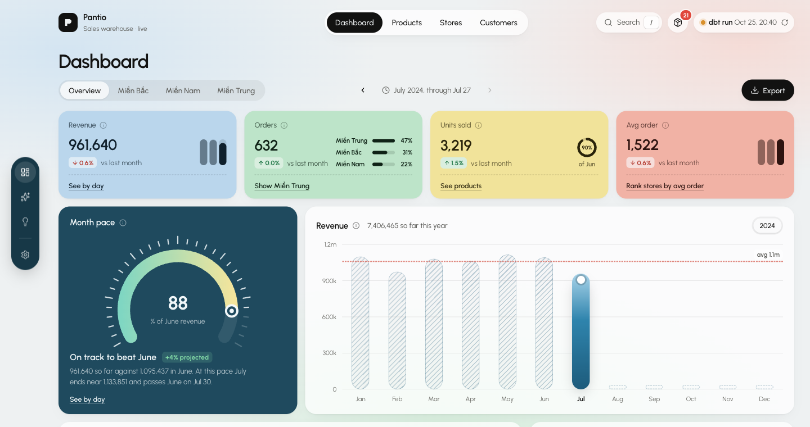

# Pantio

Sales and stock analytics for Pantio's stores: Excel exports go into Postgres, dbt shapes them into a star schema,
and a dashboard reads it.



```
data/*.xlsx → ingestion/ → bronze → dbt/ → silver → gold → api/ → dashboard/
                 (scheduled daily by airflow/)
```

| Folder       | What it does                                                                       |
|--------------|------------------------------------------------------------------------------------|
| `data/`      | Excel input files                                                                  |
| `ingestion/` | Creates the bronze tables and loads the Excel sheets into them                     |
| `lake/`      | Generated, git-ignored raw orders, inventory, deliveries, promotions and engagement |
| `dbt/`       | bronze → silver (cleaned, tested) → gold: star schema plus business rules; see `dbt/README.md` |
| `airflow/`   | The `pantio_etl` DAG: ingest, then `dbt build`                                     |
| `api/`       | FastAPI over the gold tables: `routes/` are the endpoints, `services/` the logic   |
| `dashboard/` | React + Vite dashboard; see `dashboard/README.md`                                  |
| `tests/`     | Python tests for `api/`                                                            |

## Architecture


## Setup

```bash
cp .env.example .env   # then fill in the Postgres settings
uv sync
cd dashboard && npm install
```

## Run

```bash
uv run python -m ingestion.make_lake                # Data lake: rebuild deterministic raw sources
uv run uvicorn api.main:app --reload --port 8000   # API, from the project root
cd dashboard && npm run dev                         # dashboard on http://localhost:5173
```

## API

| Endpoint                         | Use                                                               |
|----------------------------------|-------------------------------------------------------------------|
| `GET /api/warehouse`             | Every gold table the dashboard reads, and the last dbt run time   |
| `POST /api/text-to-sql`          | A question in plain words → SQL written by a model, run read-only |
| `GET /api/text-to-sql/providers` | Which providers have a key, and which one is chosen               |
| `POST /api/insights/runs`        | A business question → the agent team starts on the data lake      |
| `GET /api/insights/runs/{id}/events` | The agents' discussion and report, streamed (SSE)             |
| `POST /api/insights/runs/{id}/reply`, `/stop` | Answer an agent's question, or stop the run          |
| `/api/settings/ai`               | Provider, model and key (this computer only)                      |

## Tests

```bash
uv run python -m unittest discover -s tests -t .   # API
cd dashboard && npm test                            # dashboard, needs npm run dev running
```
